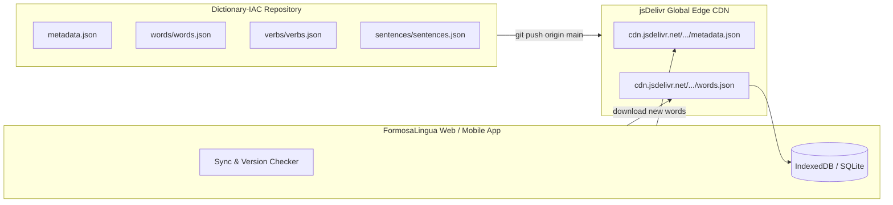

# FormosaLingua — Dictionary IAC (Infrastructure as Content)

Decoupled, version-controlled remote dictionary repository for **FormosaLingua** (Traditional Taiwanese Mandarin • 繁體中文與注音符號).

---

## 1. Overview & Architecture

**Dictionary-IAC** is an Infrastructure-as-Content (IaC) repository that separates language data from the application source code.
It acts as a **Headless Linguistic CMS** distributed globally via the **jsDelivr CDN**.



---

## 2. Global CDN Endpoints (100% Free)

All files committed to the `main` branch are instantly cached and served via jsDelivr CDN worldwide:

| Asset | jsDelivr CDN URL | Raw GitHub URL |
|---|---|---|
| **Metadata & Version** | `https://cdn.jsdelivr.net/gh/lockum/Dictionary-IAC@main/metadata.json` | `https://raw.githubusercontent.com/lockum/Dictionary-IAC/main/metadata.json` |
| **All-in-One Seed** | `https://cdn.jsdelivr.net/gh/lockum/Dictionary-IAC@main/seed_data.json` | `https://raw.githubusercontent.com/lockum/Dictionary-IAC/main/seed_data.json` |
| **Words Deck** | `https://cdn.jsdelivr.net/gh/lockum/Dictionary-IAC@main/words/words.json` | `https://raw.githubusercontent.com/lockum/Dictionary-IAC/main/words/words.json` |
| **Verbs Deck** | `https://cdn.jsdelivr.net/gh/lockum/Dictionary-IAC@main/verbs/verbs.json` | `https://raw.githubusercontent.com/lockum/Dictionary-IAC/main/verbs/verbs.json` |
| **Sentences Deck** | `https://cdn.jsdelivr.net/gh/lockum/Dictionary-IAC@main/sentences/sentences.json` | `https://raw.githubusercontent.com/lockum/Dictionary-IAC/main/sentences/sentences.json` |

---

## 3. How to Add New Words

To add new words, open `words/words.json` and append a new JSON object:

```json
{
  "id": "w_kaixin",
  "hanzi": "開心",
  "pinyin": "kāi xīn",
  "zhuyin": "ㄎㄞ ㄒㄧㄣ",
  "tr": "Mutlu / Sevinçli",
  "en": "Happy / Joyful",
  "taiwan_note": "Very common in daily life (e.g. 今天好開心).",
  "level_id": 2,
  "difficulty": "Easy",
  "category": "Emotions",
  "translations": {
    "tr": "Mutlu",
    "en": "Happy",
    "es": "Feliz",
    "de": "Glücklich",
    "fr": "Heureux",
    "it": "Felice",
    "ja": "嬉しい",
    "ko": "행복하다",
    "pt": "Feliz",
    "hi": "खुश"
  }
}
```

---

## 4. How to Release an Update

1. Edit your JSON files (`words/words.json`, `verbs/verbs.json`, etc.).
2. In `metadata.json`, bump the `version` (e.g. from `1.0.0` to `1.1.0`) and update `last_updated`.
3. Commit and push:

```bash
git add .
git commit -m "feat: add new emotion and daily life vocabulary"
git push origin main
```

Within seconds, the jsDelivr CDN and the FormosaLingua application will detect the new version and sync the vocabulary!

---

## 5. Repository Structure

```
├── README.md
├── metadata.json           # Version & delta checksums
├── seed_data.json          # Consolidated snapshot
├── words/
│   └── words.json          # All vocabulary cards
├── verbs/
│   └── verbs.json          # Taiwanese verbs & conjugations
├── sentences/
│   └── sentences.json      # Progressive daily sentences
└── curriculum/
    ├── levels.json         # Skill path levels
    └── purposes.json       # Tracks (Daily, Travel, Work, Exam)
```

---
*Maintained by Lockum for FormosaLingua • All Rights Reserved.*
